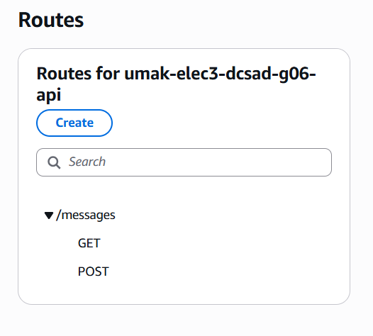
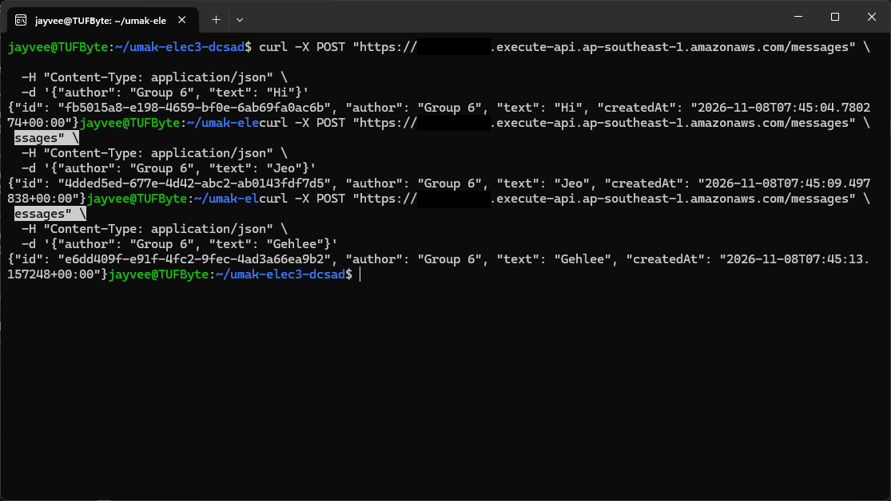
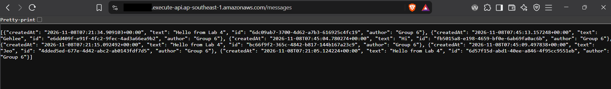
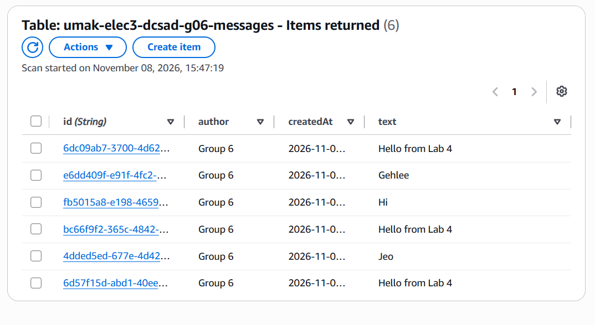

# Lab 4 Submission

## About us

- Group number: 6.
- Section: IV-DCSAD.
- Group IAM user: `dcsad-g06`.
- DynamoDB table name: `umak-elec3-dcsad-g06-messages`.
- HTTP API name: `umak-elec3-dcsad-g06-api`.

## Handler code

```python
import base64
import json
import uuid
from datetime import datetime, timezone

import boto3

GROUP_NAME = "XLR8"  # Use the same name as Seatwork 4.
TABLE_NAME = "umak-elec3-dcsad-g06-messages"

table = boto3.resource("dynamodb").Table(TABLE_NAME)

def respond(status_code, body):
    return {
        "statusCode": status_code,
        "headers": {"Content-Type": "application/json"},
        "body": json.dumps(body),
    }

def read_json_body(event):
    body = event.get("body") or "{}"
    if event.get("isBase64Encoded"):
        body = base64.b64decode(body).decode("utf-8")
    return json.loads(body)

def lambda_handler(event, context):
    route = event.get("routeKey")

    if route == "GET /messages":
        items = table.scan()["Items"]
        return respond(200, items)

    if route == "POST /messages":
        try:
            data = read_json_body(event)
        except ValueError:
            data = None
        if not isinstance(data, dict) or not data.get("text"):
            return respond(400, {"error": "Send a JSON body with a text field."})
        if len(str(data["text"])) > 280:
            return respond(400, {"error": "Keep the text at 280 characters or fewer."})
        message = {
            "id": str(uuid.uuid4()),
            "author": str(data.get("author") or GROUP_NAME)[:80],
            "text": str(data["text"]),
            "createdAt": datetime.now(timezone.utc).isoformat(),
        }
        table.put_item(Item=message)
        return respond(201, message)

    return respond(404, {"error": f"No route for {route}"})
```

## Screenshots









## Questions

1. Both routes call the same function. How does your code know which route a request came through?

   **Answer:** API Gateway includes the matched HTTP method and path in the event's `routeKey` field. The handler reads it with `route = event.get("routeKey")`. It scans the table when the value is `GET /messages`, and it validates and stores a message when the value is `POST /messages`.

2. What answer do you get when you open the invoke URL without `/messages`? Why does API Gateway answer this way, and not your function?

   **Output:**

   ```json
   {"message":"Not Found"}
   ```

   **Answer:** Opening the base invoke URL sends a `GET /` request. Our API defines `GET /messages` and `POST /messages`, so no route matches that request. API Gateway returns its own 404 response without invoking Lambda. The `$default` stage provides the base URL, but it does not create a `$default` catch-all route.

3. Your `GET /messages` route uses Scan. What happens to the cost of each GET request as the table grows to thousands of messages? Why?

   **Answer:** Reading a larger collection with Scan generally consumes more DynamoDB read request units because it examines more data. Repeating the scan for every GET therefore makes listing messages more expensive as the scanned data grows. Charges depend on the amount of data examined and its read consistency, rather than only the number of HTTP requests. The supplied handler makes one Scan call, which reads at most 1 MB and does not fetch additional pages; beyond that size, it returns only part of the collection.
