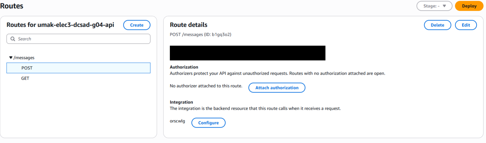
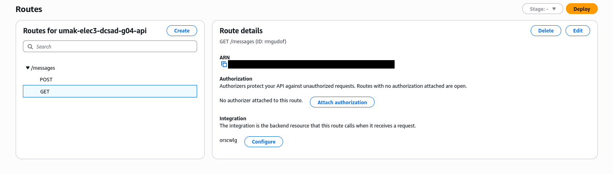
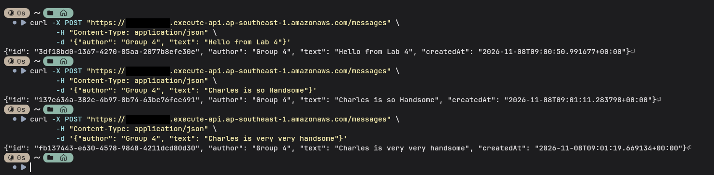
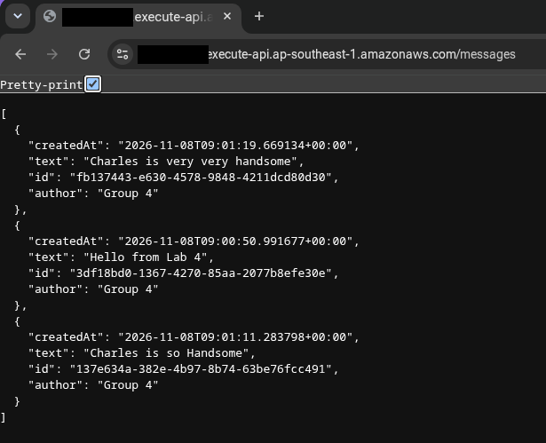
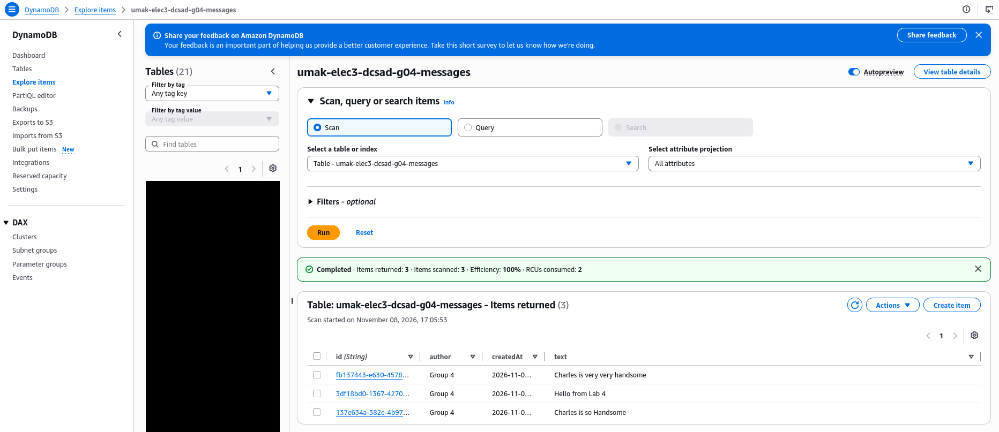

# Lab 4 Submission

## About us

- Group number: 4
- Section: IV-DCSAD
- Group IAM user: dcsad-g04
- DynamoDB table name: umak-elec3-dcsad-g04-messages
- HTTP API name: umak-elec3-dcsad-g04-api

## Handler code

```python
import base64
import json
import uuid
from datetime import datetime, timezone

import boto3

GROUP_NAME = "Group 4 of IV-DCSAD"
TABLE_NAME = "umak-elec3-dcsad-g04-messages"

table = boto3.resource("dynamodb").Table(TABLE_NAME)


def respond(status_code, body):
    return {
        "statusCode": status_code,
        "headers": {"Content-Type": "application/json"},
        "body": json.dumps(body),
    }


def read_json_body(event):
    body = event.get("body") or "{}"
    if event.get("isBase64Encoded"):
        body = base64.b64decode(body).decode("utf-8")
    return json.loads(body)


def lambda_handler(event, context):
    route = event.get("routeKey")

    if route == "GET /messages":
        items = table.scan()["Items"]
        return respond(200, items)

    if route == "POST /messages":
        try:
            data = read_json_body(event)
        except ValueError:
            data = None
        if not isinstance(data, dict) or not data.get("text"):
            return respond(400, {"error": "Send a JSON body with a text field."})
        if len(str(data["text"])) > 280:
            return respond(400, {"error": "Keep the text at 280 characters or fewer."})
        message = {
            "id": str(uuid.uuid4()),
            "author": str(data.get("author") or GROUP_NAME)[:80],
            "text": str(data["text"]),
            "createdAt": datetime.now(timezone.utc).isoformat(),
        }
        table.put_item(Item=message)
        return respond(201, message)

    return respond(404, {"error": f"No route for {route}"})
```

## Screenshots











## Questions

1. Both routes call the same function. How does your code know which route a request came through?

	A route is an HTTP method plus a path. We created only two routes, GET /messages and POST /messages, so GET and POST are the only HTTP methods allowed on /messages; a PUT or DELETE request matches no route, and API Gateway rejects it before the function runs. Both routes share the same path, so the HTTP method is what tells them apart. API Gateway sends the matched route to the function in the event's routeKey field (e.g., "GET /messages"), and the handler reads it with event.get("routeKey"): GET runs the Scan code, and POST runs the validation and PutItem code.

2. What answer do you get when you open the invoke URL without `/messages`? Why does API Gateway answer this way, and not your function?

	The answer is an HTTP 404 response code with the body {"message":"Not Found"}. API Gateway returns this itself because the API has routes only for GET /messages and POST /messages. A request for / matches no route, so API Gateway rejects it before invoking the Lambda function. The function only runs after API Gateway has matched a route and forwarded the request. The function’s own 404 body, {"error": "No route for ..."}, would appear only if a request reached the function with a routeKey that the code does not handle.

3. Your `GET /messages` route uses Scan. What happens to the cost of each GET request as the table grows to thousands of messages? Why?

	Each `GET /messages` request performs a `Scan`, which examines every item in the table rather than reading only the items the caller needs. With DynamoDB on-demand billing, the request consumes read request units based on the amount of item data read, counted in 4 KB units for eventually consistent reads. So while the table fits in one Scan page, the read cost of each GET grows roughly in proportion to the number of messages in the table. The request also becomes slower. DynamoDB returns at most 1 MB per Scan page, so if the table grows beyond that, a single `table.scan()` call returns only one page and the code would need to follow `LastEvaluatedKey` to retrieve the rest; the total work and cost to read all messages would still grow with the table. 