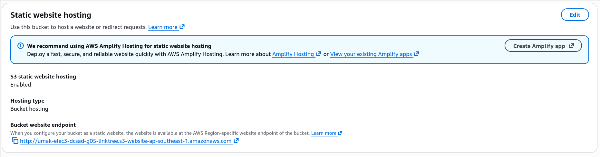
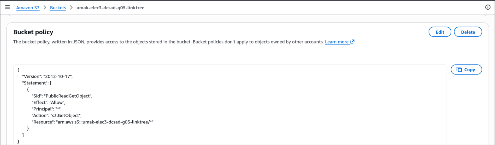
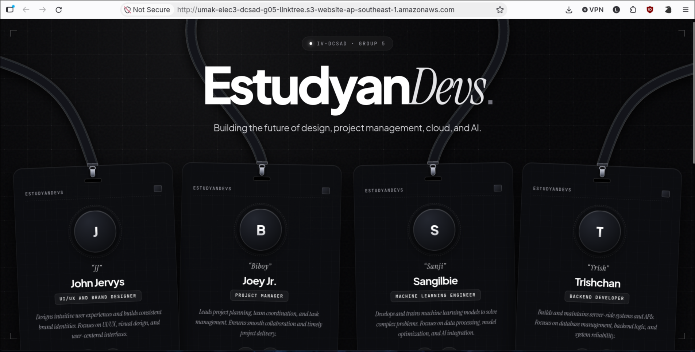

# Seatwork 3 Submission

## About us

- Group number: 05
- Section: IV-DCSAD
- Group IAM user: dcsad-g05
- Bucket name: umak-elec3-dcsad-g05-linktree
- Website endpoint: http://umak-elec3-dcsad-g05-linktree.s3-website-ap-southeast-1.amazonaws.com

## Screenshots

## Contribution

| GitHub username | What this groupmate did |
| --- | --- |
| TrishchanJimenez | Captured the three screenshots and completed submission.md |
| JoeyRVisayaJr | Enabled static website hosting |
| scaoile | Turned off Block Public Access and added the bucket policy |
| jjcabalo | Created the S3 bucket and uploaded index.html |
