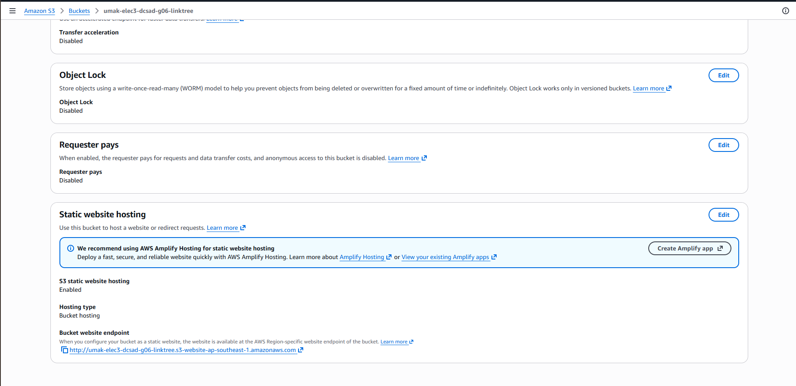
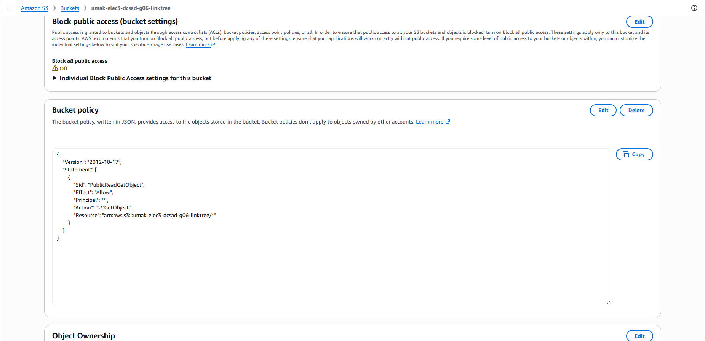
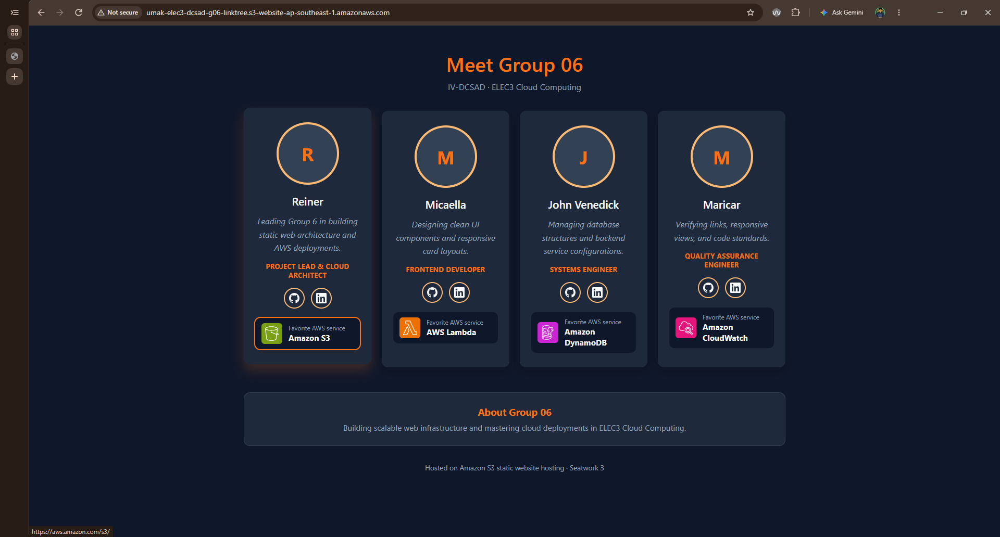

# Seatwork 3 Submission

## About us

- Group number: Group 06
- Section: IV-DCSAD
- Group IAM user: dcsad-g06
- Bucket name: umak-elec3-dcsad-g06-linktree
- Website endpoint: http://umak-elec3-dcsad-g06-linktree.s3-website-ap-southeast-1.amazonaws.com

## Screenshots

## Contribution

| GitHub username | What this groupmate did |
| --- | --- |
| astennue | AWS S3 Bucket setup, policy configuration, screenshots documentation, and PR management |
| micasanf | Static website hosting verification and testing |
| JayveeOnUni | Endpoint validation and live site link testing |
| morense-umak | Document review and repository testing |