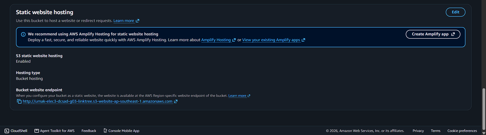
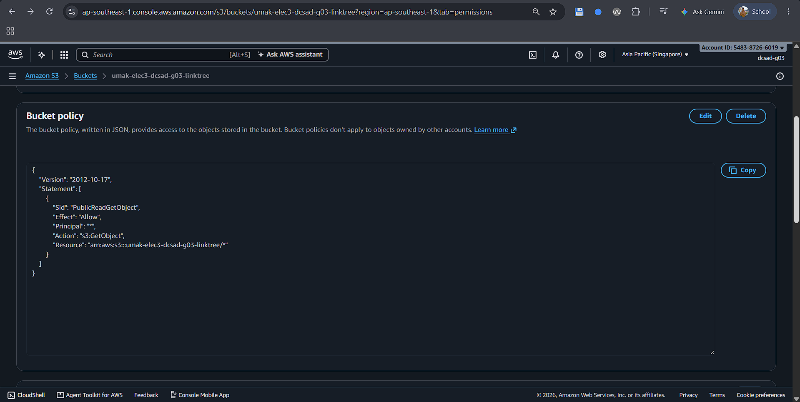
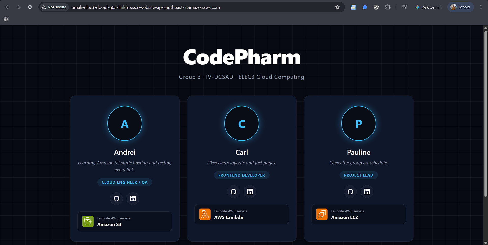

# Seatwork 3 Submission

## About us

- Group number: 3
- Section: DCSAD
- Group IAM user: dcsad-g03
- Bucket name: umak-elec3-dcsad-g03-linktree
- Website endpoint: http://umak-elec3-dcsad-g03-linktree.s3-website-ap-southeast-1.amazonaws.com

## Screenshots

## Contribution

| GitHub username | What this groupmate did |
| --- | --- |
| @Vinjin2705 | Created the S3 bucket, uploaded the index.html page, and handled submission |
| @abulotano | Configured static website hosting and turned off Block Public Access |
| @plngpc | Authored the bucket policy and verified the website endpoint |