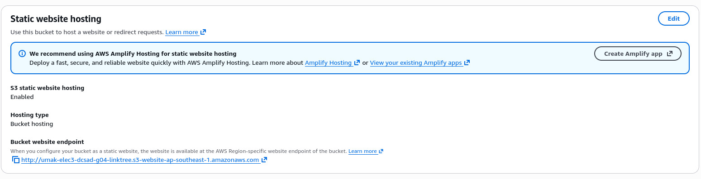
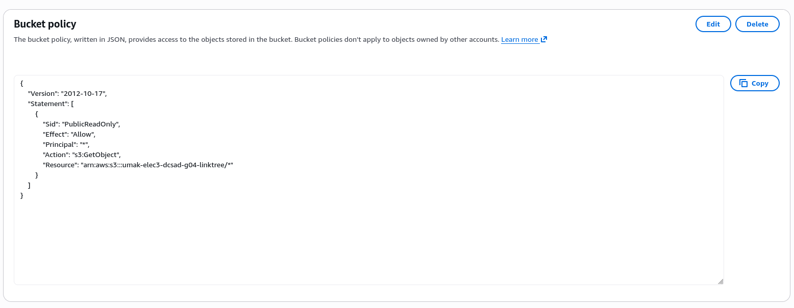
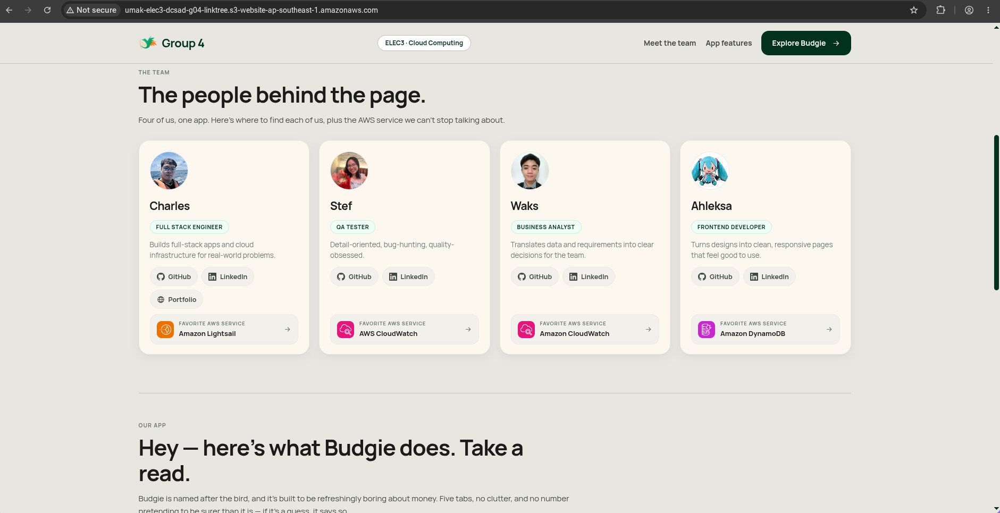

# Seatwork 3 Submission

## About us

- Group number: 4
- Section: IV-DCSAD
- Group IAM user: dcsad-g04
- Bucket name: umak-elec3-dcsad-g04-linktree
- Website endpoint: http://umak-elec3-dcsad-g04-linktree.s3-website-ap-southeast-1.amazonaws.com

## Screenshots

## Contribution

| GitHub username | What this groupmate did |
| --- | --- |
| CharlesTogle | Created the S3 bucket. |
| vivrelavie | Created the bucket policy. |
| JoaquinLuisGuevarra96 | Uploaded index.html and enabled static website hosting. |
| AJPSJ | Verified that the website was up and working. |
