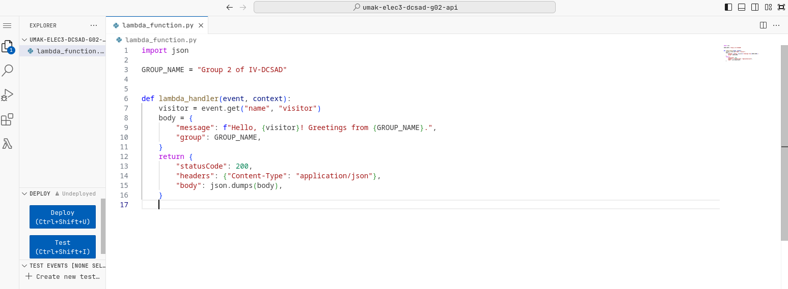
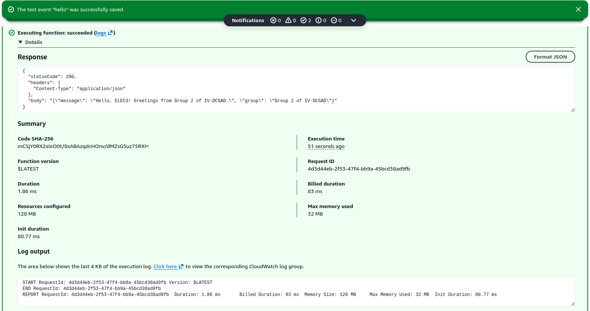
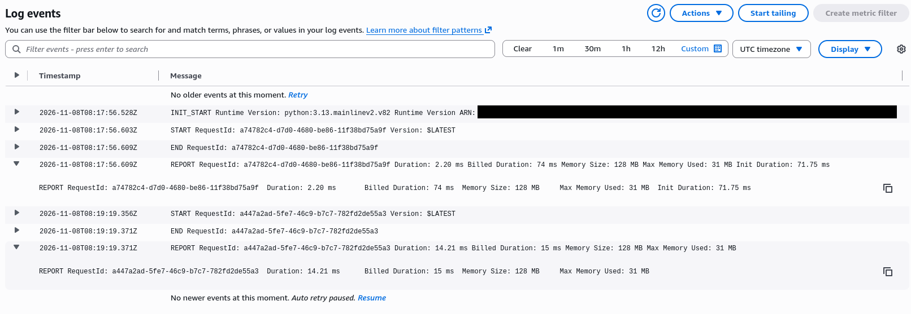

# Seatwork 4 Submission

## About us

- Group number: 02
- Section: IV-DCSAD
- Group IAM user: dcsad-g02
- Function name: umak-elec3-dcsad-g02-api

## Handler code

```python
import json

GROUP_NAME = "Group 2 of IV-DCSAD"


def lambda_handler(event, context):
    visitor = event.get("name", "visitor")
    body = {
        "message": f"Hello, {visitor}! Greetings from {GROUP_NAME}.",
        "group": GROUP_NAME,
    }
    return {
        "statusCode": 200,
        "headers": {"Content-Type": "application/json"},
        "body": json.dumps(body),
    }
```

## REPORT lines

First run, a cold start:

```text
REPORT RequestId: a74782c4-d7d0-4680-be86-11f38bd75a9f	Duration: 2.20 ms	Billed Duration: 74 ms	Memory Size: 128 MB	Max Memory Used: 31 MB	Init Duration: 71.75 ms
```

Second run, a warm start:

```text
REPORT RequestId: a447a2ad-5fe7-46c9-b7c7-782fd2de55a3	Duration: 14.21 ms	Billed Duration: 15 ms	Memory Size: 128 MB	Max Memory Used: 31 MB
```

## Question

Why does the second REPORT line have no Init Duration?

The second REPORT line has no Init Duration because AWS Lambda reused the execution environment from the previous run. Since it did not need to initialize a new environment, there was no initialization time to report.

## Screenshots







## Contribution

| GitHub username | What this groupmate did |
| --- | --- |
| Zanis3 | Set up the Lambda function and configured its settings. |
| johnlenardtaligatos16 | Created and tested the Lambda function's handler code. |
| mmanzanilloa12241800-sudo | Checked the CloudWatch logs, recorded the REPORT lines, and prepared the submission screenshots. |
