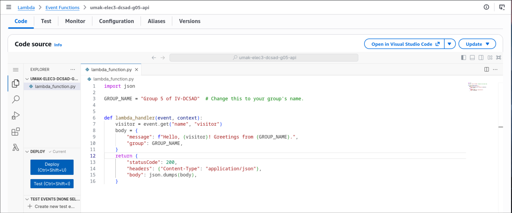
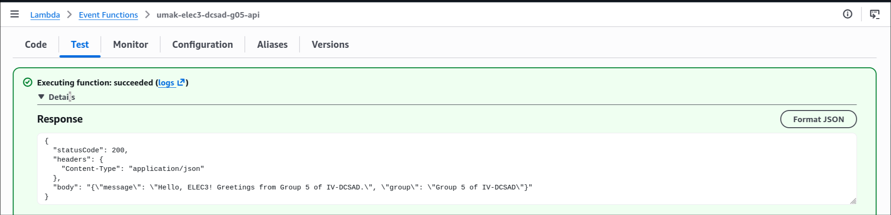
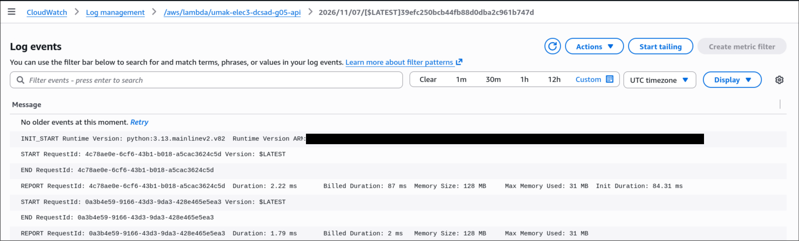

# Seatwork 4 Submission

## About us

- Group number: dcsad-g05
- Section: IV-DCSAD
- Group IAM user: dcsad-g05
- Function name: umak-elec3-dcsad-g05-api

## Handler code

```python
import json

GROUP_NAME = "Group 5 of IV-DCSAD"  # Change this to your group's name.


def lambda_handler(event, context):
    visitor = event.get("name", "visitor")
    body = {
        "message": f"Hello, {visitor}! Greetings from {GROUP_NAME}.",
        "group": GROUP_NAME,
    }
    return {
        "statusCode": 200,
        "headers": {"Content-Type": "application/json"},
        "body": json.dumps(body),
    }
```

## REPORT lines

First run, a cold start:

```text
REPORT RequestId: 4c78ae0e-6cf6-43b1-b018-a5cac3624c5d	Duration: 2.22 ms	Billed Duration: 87 ms	Memory Size: 128 MB	Max Memory Used: 31 MB	Init Duration: 84.31 ms	
```

Second run, a warm start:

```text
REPORT RequestId: 0a3b4e59-9166-43d3-9da3-428e465e5ea3	Duration: 1.79 ms	Billed Duration: 2 ms	Memory Size: 128 MB	Max Memory Used: 31 MB	
```

## Question

Why does the second REPORT line have no Init Duration?

The second run was a warm start. Lambda reused the execution environment that the first run had already created, so it did not need to start a new runtime or load the function code again. `Init Duration` appears only when Lambda creates a new execution environment, which is a cold start.

## Screenshots







## Contribution

| GitHub username | What this groupmate did |
| --- | --- |
| TrishchanJimenez | Created the Lambda function in Singapore with Python 3.13 and the group execution role |
| JoeyRVisayaJr | Wrote and deployed the handler code, then captured `code.png` |
| scaoile | Created the `hello` test event, ran the function twice, and captured `test.png` |
| jjcabalo | Found both REPORT lines in CloudWatch and captured `report.png` |
