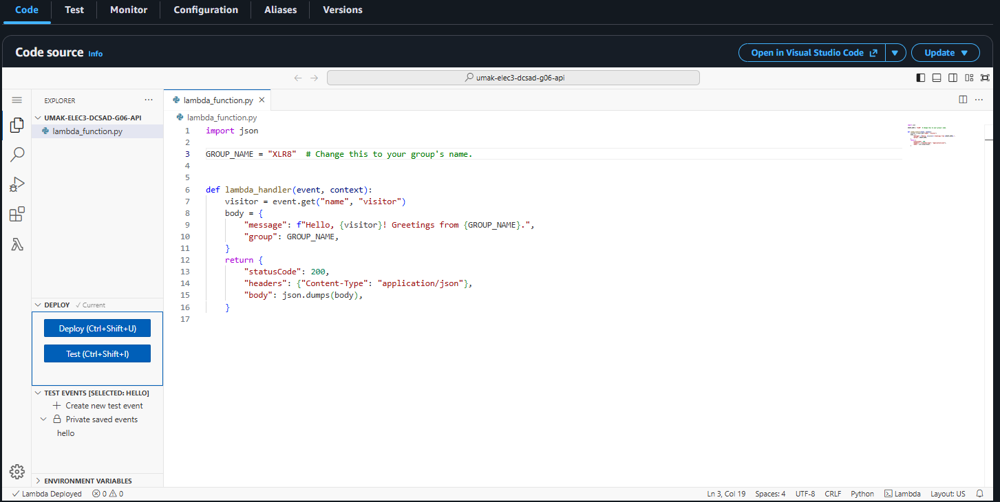
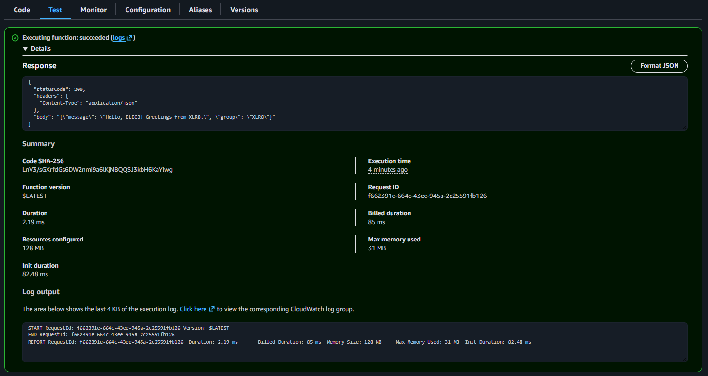
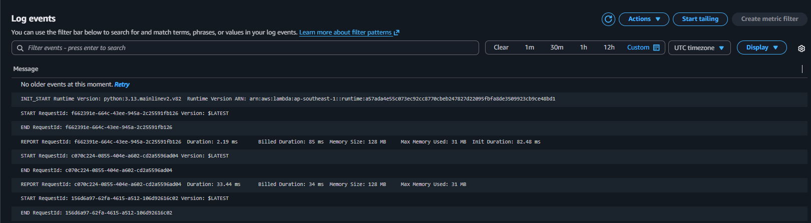

# Seatwork 4 Submission

## About us

- Group number: 6.
- Section: IV-DCSAD.
- Group IAM user: `dcsad-g06`.
- Function name: `umak-elec3-dcsad-g06-api`.

## Handler code

```python
import json

GROUP_NAME = "XLR8"  # Change this to your group's name.

def lambda_handler(event, context):
    visitor = event.get("name", "visitor")
    body = {
        "message": f"Hello, {visitor}! Greetings from {GROUP_NAME}.",
        "group": GROUP_NAME,
    }
    return {
        "statusCode": 200,
        "headers": {"Content-Type": "application/json"},
        "body": json.dumps(body),
    }
```

## REPORT lines

First run, a cold start:

```text
REPORT RequestId: f662391e-664c-43ee-945a-2c25591fb126	Duration: 2.19 ms	Billed Duration: 85 ms	Memory Size: 128 MB	Max Memory Used: 31 MB	Init Duration: 82.48 ms
```

Second run, a warm start:

```text
REPORT RequestId: c070c224-0855-404e-a602-cd2a5596ad04	Duration: 33.44 ms	Billed Duration: 34 ms	Memory Size: 128 MB	Max Memory Used: 31 MB
```

## Question

Why does the second REPORT line have no Init Duration?

The second REPORT line has no Init Duration because Lambda reused the execution environment initialized during the first invocation. It did not need to start the Python runtime or load the function code again. This is called a warm start.

## Screenshots







## Contribution

| GitHub username | What this groupmate did |
| --- | --- |
| astennue | Created and configured the Lambda function. |
| micasanf | Customized and deployed the handler. |
| JayveeOnUni | Tested the function and collected REPORT lines. |
| morense-umak | Prepared screenshots and submission files. |
