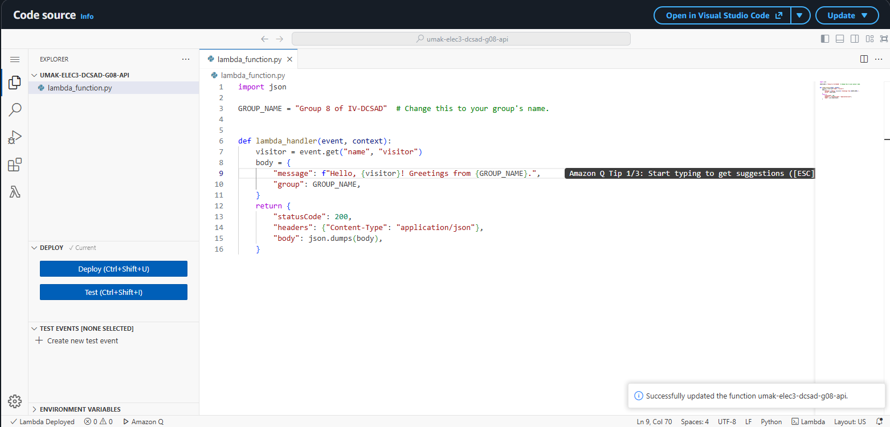
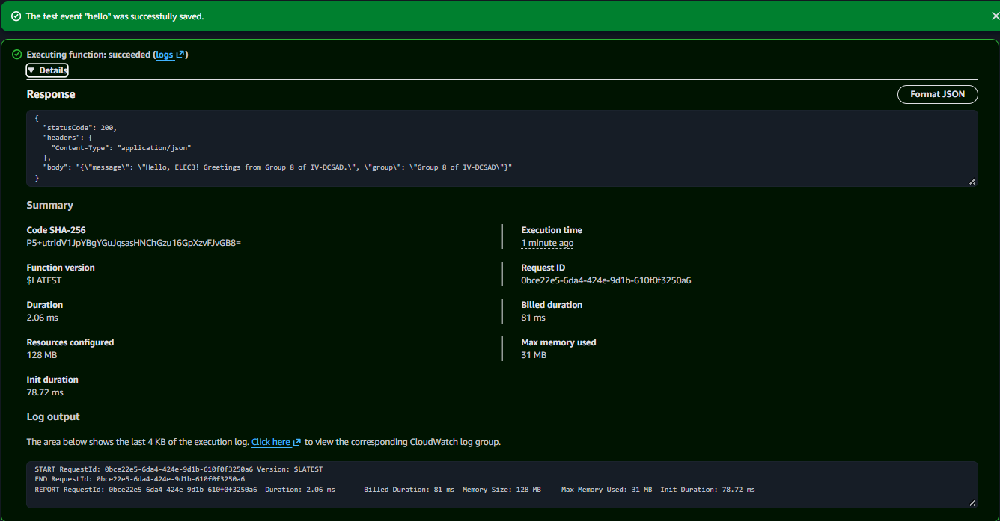
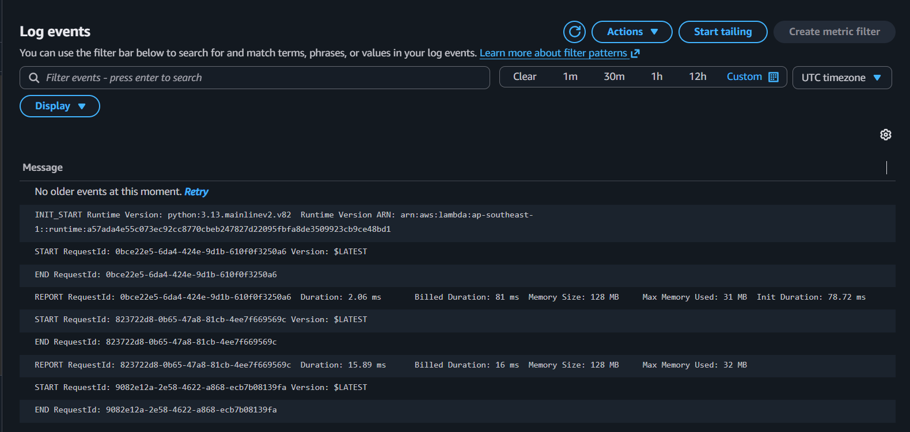

# Seatwork 4 Submission

<!--
How to use this template:

1. Copy this file to submissions/seatwork-4/group-<number>/submission.md
2. Replace every <answer> with your group's answer. Delete the angle brackets too.
3. Save code.png, test.png, and report.png in the same folder.
4. Crop the AWS console top bar out of all three screenshots, and cover every ARN.
5. Write GitHub usernames, not full names or student numbers.
-->

## About us

- Group number: 8
- Section: IV - DCSAD
- Group IAM user: dcsad-g08
- Function name: /aws/lambda/umak-elec3-dcsad-g08-api

## Handler code

```python

import json

GROUP_NAME = "Group 08 of IV-DCSAD"  # Replace with your actual group name.


def lambda_handler(event, context):
    visitor = event.get("name", "visitor")

    body = {
        "message": f"Hello, {visitor}! Greetings from {GROUP_NAME}.",
        "group": GROUP_NAME,
    }

    return {
        "statusCode": 200,
        "headers": {"Content-Type": "application/json"},
        "body": json.dumps(body),
    }

```

## REPORT lines

First run, a cold start:

```text
REPORT RequestId: 0bce22e5-6da4-424e-9d1b-610f0f3250a6	Duration: 2.06 ms	Billed Duration: 81 ms	Memory Size: 128 MB	Max Memory Used: 31 MB	Init Duration: 78.72 ms	
```

Second run, a warm start:

```text
REPORT RequestId: 823722d8-0b65-47a8-81cb-4ee7f669569c	Duration: 15.89 ms	Billed Duration: 16 ms	Memory Size: 128 MB	Max Memory Used: 32 MB	
```

## Question

Why does the second REPORT line have no Init Duration?

The second execution is a warm start. During the first execution, AWS Lambda created and initialized an execution environment, which is why the first REPORT line includes an Init Duration. When the function was executed again immediately afterward, Lambda reused the existing execution environment instead of creating a new one. Therefore, the second execution did not require another initialization, and its REPORT line has no Init Duration.

## Screenshots

code.png


test.png


report.png


## Contribution

| GitHub username | What this groupmate did |
| --- | --- |
| micmiccc16 | Developed and deployed the Python Lambda handler. |
| jdyyy1 | Examined CloudWatch logs, recorded REPORT lines, and prepared the submission. |
| shaeluh | Developed and deployed the Python Lambda handler. |
| MarcoLasaga | Created the Lambda function and configured the execution role. Created the test event and performed the function executions. |
