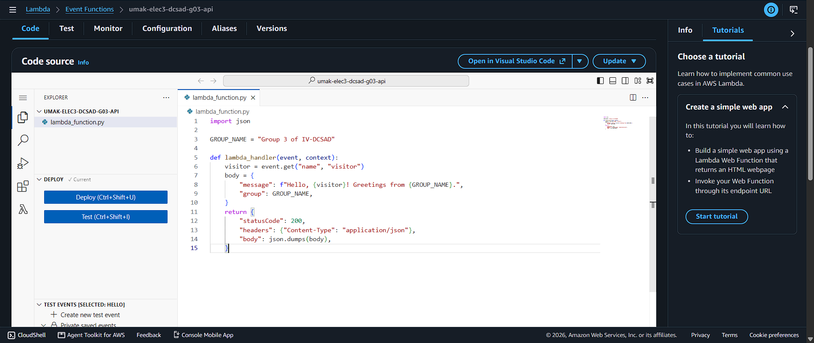
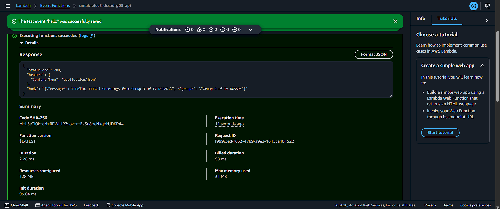
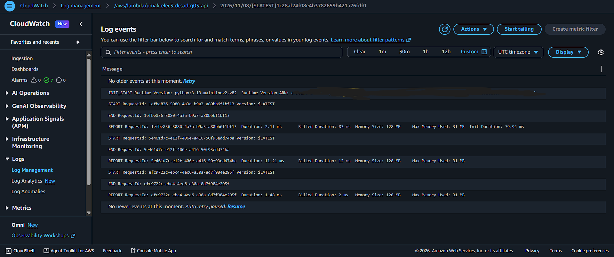

# Seatwork 4 Submission

<!--
How to use this template:

1. Copy this file to submissions/seatwork-4/group-<number>/submission.md
​2. Replace every <answer> with your group's answer. Delete the angle brackets too.
3. Save code.png, test.png, and report.png in the same folder.
4. Crop the AWS console top bar out of all three screenshots, and cover every ARN.
5. Write GitHub usernames, not full names or student numbers.
-->

## About us

- Group number: 3
- Section: DCSAD
- Group IAM user: dcsad-g03
- Function name: umak-elec3-dcsad-g03-api

## Handler code

```python
import json

GROUP_NAME = "Group 3 of IV-DCSAD"

def lambda_handler(event, context):
    visitor = event.get("name", "visitor")
    body = {
        "message": f"Hello, {visitor}! Greetings from {GROUP_NAME}.",
        "group": GROUP_NAME,
    }
    return {
        "statusCode": 200,
        "headers": {"Content-Type": "application/json"},
        "body": json.dumps(body),
    }
```

## REPORT lines

First run, a cold start:

```text
REPORT RequestId: 1efbe836-5080-4a3a-b9a3-a80bb6f1bf13 Duration: 2.11 ms	Billed Duration: 83 ms	Memory Size: 128 MB	Max Memory Used: 31 MB	Init Duration: 79.94 ms
```

Second run, a warm start:

```text
REPORT RequestId: 5c461d7c-e12f-486e-a416-58f93cdd74ba Duration: 11.21 ms	Billed Duration: 12 ms	Memory Size: 128 MB	Max Memory Used: 31 MB
```

## Question

Why does the second REPORT line have no Init Duration?

The second run was a "warm start." AWS Lambda kept the execution environment from the first run active and reused it. Because the environment and the Python runtime were already initialized and the code was already loaded, it completely skipped the initialization phase.

## Screenshots







## Contribution

| GitHub username | What this groupmate did |
| --- | --- |
| @Vinjin2705 | Created the AWS Lambda function, deployed the Python handler code, and managed the GitHub Pull Request submission. |
| @abulotano | Configured the JSON test event, executed the cold and warm start runs, and verified the statusCode 200 response. |
| @plngpc | Navigated the CloudWatch log streams, extracted the REPORT lines, and masked the sensitive ARNs and Account IDs in the screenshots. |