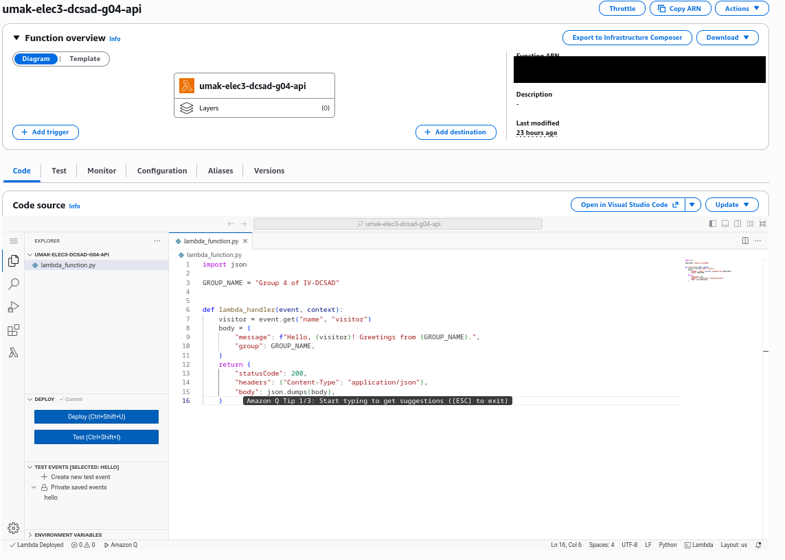
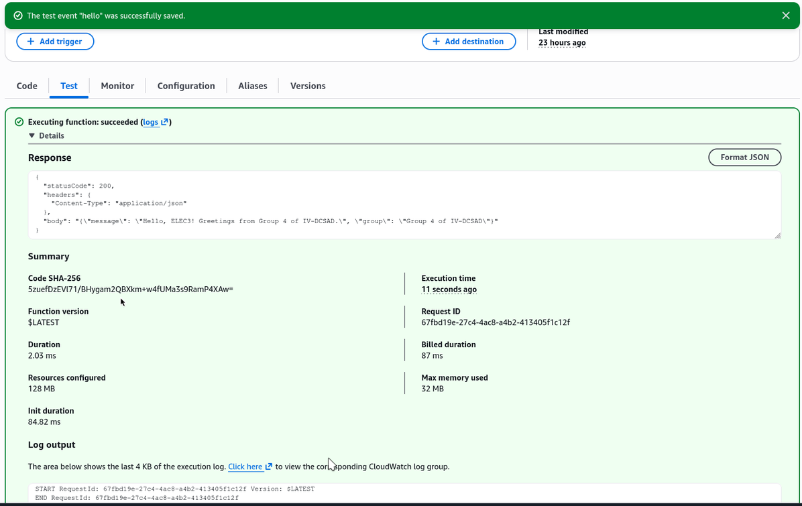
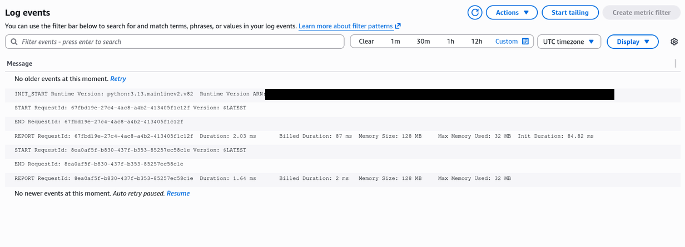

# Seatwork 4 Submission

## About us

- Group number: 4
- Section: IV-DCSAD
- Group IAM user: dcsad-g04
- Function name: umak-elec3-dcsad-g04-api

## Handler code

```python
import json

GROUP_NAME = "Group 4 of IV-DCSAD"


def lambda_handler(event, context):
    visitor = event.get("name", "visitor")
    body = {
        "message": f"Hello, {visitor}! Greetings from {GROUP_NAME}.",
        "group": GROUP_NAME,
    }
    return {
        "statusCode": 200,
        "headers": {"Content-Type": "application/json"},
        "body": json.dumps(body),
    }
```

## REPORT lines

First run, a cold start:

```text
REPORT RequestId: 67fbd19e-27c4-4ac8-a4b2-413405f1c12f    Duration: 2.03 ms    Billed Duration: 87 ms    Memory Size: 128 MB    Max Memory Used: 32 MB    Init Duration: 84.82 ms
```

Second run, a warm start:

```text
REPORT RequestId: 8ea0af5f-b830-437f-b353-85257ec58c1e    Duration: 1.64 ms    Billed Duration: 2 ms    Memory Size: 128 MB    Max Memory Used: 32 MB
```

## Question

Why does the second REPORT line have no Init Duration?

The second REPORT line shows no Init Duration because the first run was a cold start: Lambda created a new execution environment and finished initialization there (starting Python and loading our code). The second run started in a warm state, so Lambda reused that same execution environment and did not need to initialize again. Lambda only removes an execution environment after it has been idle for a while, so a run after a long gap, or after a new deploy, is a cold start again.

## Screenshots







## Contribution

| GitHub username | What this groupmate did |
| --- | --- |
| vivrelavie | Step 1: Created the Lambda function with Python 3.13 with the custom execution role |
| JoaquinLuisGuevarra96 | Step 2: Wrote the handler script to return the greeting as JSON |
| AJPSJ | Step 3: Created a test event "hello" and ran it twice |
| CharlesTogle | Step 4: Found the REPORT lines in CloudWatch |
