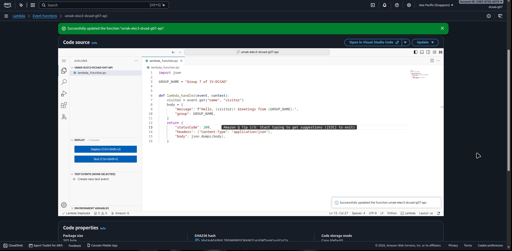
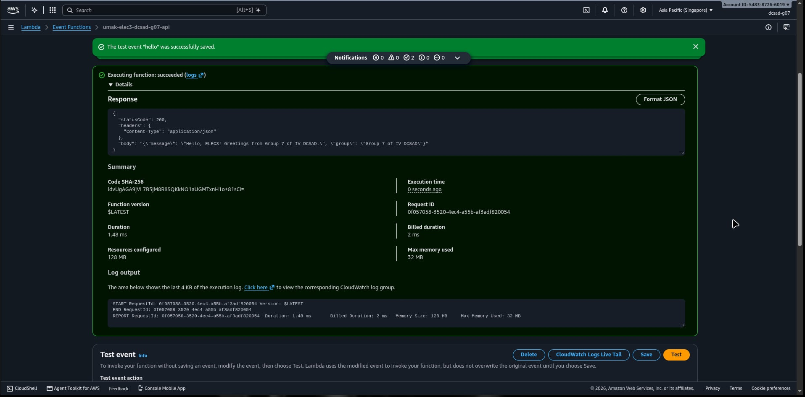
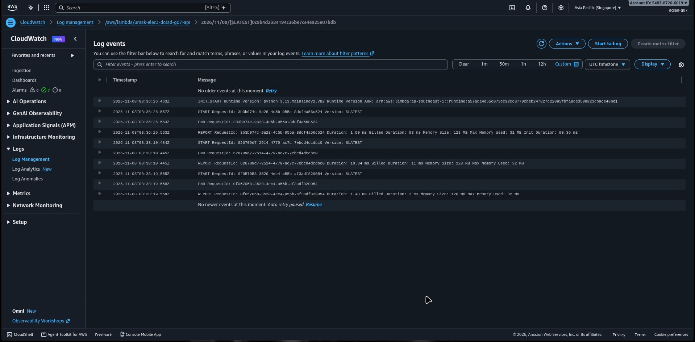

# Seatwork 4 Submission

<!--
How to use this template:

1. Copy this file to submissions/seatwork-4/group-<number>/submission.md
2. Replace every <answer> with your group's answer. Delete the angle brackets too.
3. Save code.png, test.png, and report.png in the same folder.
4. Crop the AWS console top bar out of all three screenshots, and cover every ARN.
5. Write GitHub usernames, not full names or student numbers.
-->

## About us

- Group number: 7
- Section: IV-DCSAD
- Group IAM user: dcsad-g07
- Function name: umak-elec3-dcsad-g07-api

## Handler code

```python
import json

GROUP_NAME = "Group 7 of IV-DCSAD"


def lambda_handler(event, context):
    visitor = event.get("name", "visitor")
    body = {
        "message": f"Hello, {visitor}! Greetings from {GROUP_NAME}.",
        "group": GROUP_NAME,
    }
    return {
        "statusCode": 200,
        "headers": {"Content-Type": "application/json"},
        "body": json.dumps(body),
    }
```

## REPORT lines

First run, a cold start:

```text
REPORT RequestId: 3b3bc74c-9d28-4cbb-955a-bdcf4a56c524 Duration: 1.30 ms Billed Duration: 93 ms Memory Size: 128 MB Max Memory Used: 31 MB Init Duration: 91.36 ms
```

Second run, a warm start:

```text
REPORT RequestId: 826789d7-2514-4770-ac7c-7ebcd4dcdbc0 Duration: 10.81 ms Billed Duration: 11 ms Memory Size: 128 MB Max Memory Used: 32 MB
```

## Question

Why does the second REPORT line have no Init Duration?

The first invocation of an AWS Lambda function is a cold start. Lambda must provision a new microVM execution environment (container), initialize the Python 3.13 runtime, and load the handler code (`lambda_function.py`). The duration of this setup is measured and recorded as `Init Duration`. After the first execution finishes, Lambda keeps the execution environment alive for a period of time to serve subsequent invocations. The second invocation reuses this already-initialized, warm environment. Because the execution environment and runtime were already in memory, no initialization was required, resulting in a warm start with no `Init Duration`.

## Screenshots







## Contribution

| GitHub username | What this groupmate did |
| --- | --- |
| ichannnj | Created Lambda function umak-elec3-dcsad-g07-api and deployed handler code |
| CPCNarido | Created test event hello and executed function runs |
| TroyMichaelCamarillo | Located CloudWatch log streams and extracted REPORT lines |
| Motea47 | Captured and sanitized screenshots, answered technical question, prepared submission |
